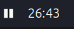
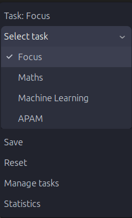
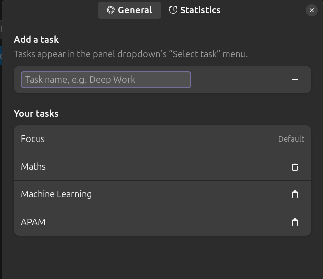
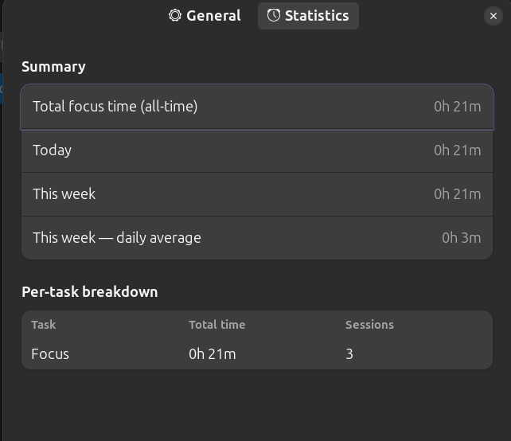

# Focus Tracker

A GNOME Shell extension that puts a stopwatch in the top panel, ties each focus session to a named task, and keeps a running history you can review from the preferences window.



- **Shell versions:** 46, 47, 48
- **UUID:** `focus-tracker@haris11.local`
- **License:** GPL-3.0 (see [LICENSE](LICENSE))

---

## Features

### Panel indicator

An alarm icon sits in the top bar. The elapsed time appears next to it only once a session has started, so the panel stays quiet when you are not tracking.

| Action          | Result                                                     |
| --------------- | ---------------------------------------------------------- |
| **Left click**  | Start / pause the stopwatch (also closes the menu if open) |
| **Right click** | Open the menu                                              |

The icon reflects the state: an alarm icon when idle, a playback icon once a session is under way. The clock reads `MM:SS`, and rolls over to `H:MM:SS`past an hour.

Timing uses the monotonic clock, so the count is not disturbed by system clock changes.

### Menu



- **Task: `<name>`** — a non-interactive line showing the active task.
- **Select task** — a submenu listing every task, with a checkmark on the active one. Picking a task makes it active immediately.
- **Save** — writes the current elapsed time as a session against the active task, then resets the stopwatch. Does nothing if the stopwatch was never
  started.
- **Reset** — clears the stopwatch and discards the running session without saving.
- **Manage tasks** — opens preferences on the _General_ page.
- **Statistics** — opens preferences on the _Statistics_ page.

Pausing does **not** end a session. A session runs from the first start until you hit Save or Reset, so you can pause and resume as often as you like and still record one continuous block of focus time.

### Preferences — General



- **Add a task** — type a name and press <kbd>Enter</kbd> or the **+** button. Names are trimmed, and duplicates are ignored.
- **Your tasks** — every task with a trash button to delete it. Deleting the active task falls the active selection back to `Focus`.
- **`Focus`** is the default task. It is always present, always first, and cannot be deleted — it is the fallback whenever no valid task is selected.

The task list is shared live with the panel menu through GSettings, so edits show up in the dropdown without restarting anything.

### Preferences — Statistics



Computed from the saved session history each time the page is built:

- **Total focus time (all-time)**
- **Today** — sessions whose start date is today (local time)
- **This week** — sessions since Monday (local time)
- **This week — daily average** — the week total divided by the number of days elapsed so far this week, so a partial week is not diluted by days that have not happened yet
- **Per-task breakdown** — total time and session count per task, sorted by time descending

---

## Data storage

Sessions are stored as a JSON array in:

```
~/.local/share/focus-tracker@haris11.local/sessions.json
```

Each entry looks like:

```json
{
  "id": "3f1c2f4a-...",
  "task": "Machine Learning",
  "mode": "stopwatch",
  "start": "2026-08-22T16:41:07+05:30",
  "end": "2026-08-22T17:07:50+05:30",
  "duration_seconds": 1603
}
```

Durations are stored in whole seconds; timestamps are local-time ISO 8601.

**Failure handling.** Reads and writes are asynchronous and serialised through a promise queue, so concurrent saves cannot interleave. If `sessions.json` is missing or empty, it is treated as an empty history. If it exists but cannot be read or parsed, the extension **refuses to write over it** and shows a desktop
notification once, so a corrupt or unreadable file is never silently replaced with a fresh one.

## Settings

Schema: `org.gnome.shell.extensions.focus-tracker`

| Key           | Type | Default     | Purpose                                |
| ------------- | ---- | ----------- | -------------------------------------- |
| `tasks-list`  | `as` | `["Focus"]` | Known task names                       |
| `active-task` | `s`  | `"Focus"`   | Task new sessions are recorded against |
| `prefs-page`  | `s`  | `"general"` | Page to open the preferences window on |

`prefs-page` is what lets _Manage tasks_ and _Statistics_ in the menu jump
straight to the right page.

## Installation

Clone into the extensions directory under the exact UUID:

```sh
git clone <repo> ~/.local/share/gnome-shell/extensions/focus-tracker@haris11.local
cd ~/.local/share/gnome-shell/extensions/focus-tracker@haris11.local
glib-compile-schemas schemas/
```

Then reload the shell:

- **Xorg:** <kbd>Alt</kbd>+<kbd>F2</kbd>, type `r`, <kbd>Enter</kbd>
- **Wayland:** log out and back in

Enable it:

```sh
gnome-extensions enable focus-tracker@haris11.local
gnome-extensions prefs focus-tracker@haris11.local   # open preferences
```

## Development

| File                             | Responsibility                                        |
| -------------------------------- | ----------------------------------------------------- |
| [extension.js](extension.js)     | Panel button, stopwatch state machine, menu           |
| [prefs.js](prefs.js)             | Adwaita preferences window (General + Statistics)     |
| [storage.js](storage.js)         | `sessions.json` reading/writing, `SessionStore` queue |
| [utils.js](utils.js)             | Task normalisation, time formatting, statistics       |
| [schemas/](schemas/)             | GSettings schema                                      |
| [stylesheet.css](stylesheet.css) | Panel indicator styling                               |

`prefs.js` runs in a separate process from `extension.js` and shares no state with it — GSettings and `sessions.json` are the only channels between them.

Watch the logs while working:

```sh
journalctl -f -o cat /usr/bin/gnome-shell            # extension.js
journalctl -f -o cat /usr/bin/gjs                    # prefs.js
```

Remember to re-run `glib-compile-schemas schemas/` after any schema change.

## Known limitations

- A running stopwatch is not persisted across a shell restart or logout; unsaved time is lost.
- The Statistics page is built when the window opens and does not live-update while it is open.
- Time is attributed to the task active at the moment you press **Save**, not to the one active when the session began.
